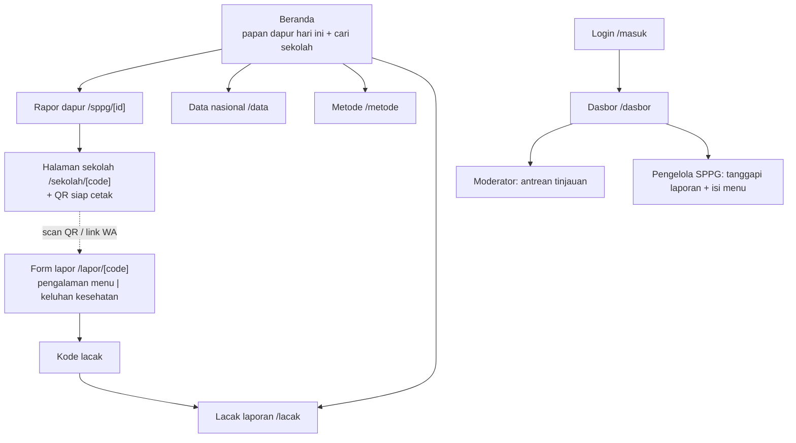
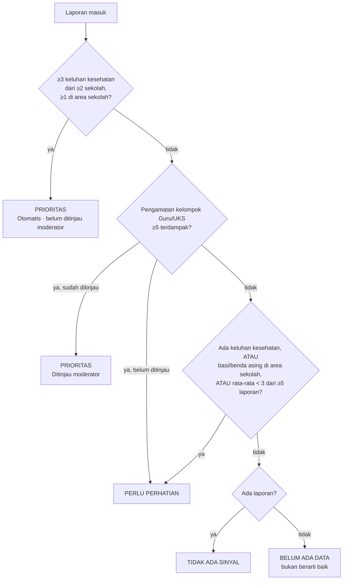
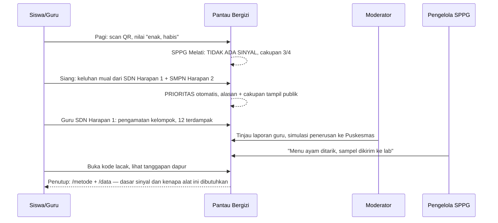

# PRD Pantau Bergizi V2.1

**Versi:** 2.1, 29 Oktober 2026. Menggantikan V2, V3.1 (beserta Addendum A–D), dan V4 gabungan. Dokumen lama hanya disimpan sebagai arsip.
**Lomba:** Web In Action, MIA 2026, bertema "Designing Digital Futures – Powering Public Transparency"
**Subtema utama:** Civic Reporting & Accountability
**Subtema pendamping:** Public Service Tracking. Data-Driven Decision Support dan Open Government Data hanya berperan sebagai pendukung.
**Pitch satu kalimat:** Radar MBG menampilkan menu dari dapur, sedangkan Pantau Bergizi menampilkan pengalaman penerimanya: rapor harian per dapur, bukan kotak aduan.

> **Klasifikasi data:** Semua dapur, sekolah, laporan, dan menu di "Kota Sukamaju" adalah **SIMULASI**. Angka nasional di halaman Data dikutip dari pemberitaan, lengkap dengan sumber dan tanggalnya. Pantau Bergizi adalah platform sipil independen, bukan sistem resmi BGN. Produk ini tidak mendiagnosis dan tidak menjanjikan pencegahan keracunan. Fungsinya membantu menentukan dapur mana yang perlu diperiksa lebih dulu.

### Perubahan dari V2

| Bagian | V2 | V2.1 | Asal |
|---|---|---|---|
| Klaim masalah | "Tidak ada data publik per dapur" | Data menu per sekolah sudah ada di Radar MBG. Yang belum ada adalah pengalaman penerima per dapur. | Riset Radar MBG |
| Label status | Bahaya / Waspada / Aman / Belum ada data | **Prioritas / Perlu perhatian / Tidak ada sinyal / Belum ada data** | V4, dipendekkan |
| Jalur cepat Guru/UKS | Langsung Bahaya | **Perlu perhatian** sampai ditinjau moderator, lalu naik ke **Prioritas** | V4 |
| Form | Satu form empat langkah | **Dua jalur dalam satu pintu:** pengalaman menu dan keluhan kesehatan | V4 |
| Tanggal | Selalu hari ini | Ada **tanggal konsumsi**, bisa mundur sampai 30 hari | V4 |
| Batas laporan | 2 per perangkat + IP | 1 survei per perangkat per sekolah per tanggal konsumsi. **IP hanya ditandai, tidak memblokir**, karena satu wifi sekolah dipakai bersama. | V4 |
| Duplikat dan waktu | Status ikut jendela 24 jam | Ada **episode** yang tetap tercatat, dan laporan duplikat dihitung satu kali | V4 |
| Privasi | Kode lacak acak | Kode lacak disimpan sebagai **hash**, koordinat tidak disimpan | V4 |
| Database | Vendor belum ditentukan | **PostgreSQL**, sekitar 7 tabel | V3.1 Addendum D, dipangkas |

Yang **tidak** diambil dari V3.1/V4:
- persetujuan PIC sebagai gerbang lapor
- jendela 90 menit
- QR per ompreng
- skala 1–10
- anggaran per porsi
- Super Admin
- 16 model data dengan versioning
- migrasi dari aplikasi V3.1

---

## 1. Konsep

### 1.1 Masalah

- **Insiden keamanan pangan MBG terjadi berulang.** Pada Januari–September 2025 tercatat **6.457 korban**, 4.147 di antaranya di Jawa ([Metro TV, rapat BGN–Komisi IX, 1 Okt 2025](https://www.metrotvnews.com/read/bVDCjdx9-januari-september-2025-jumlah-korban-insiden-mbg-capai-6-457-orang)).
- **Skala program sangat besar.** Ada **27.485 dapur**, dengan anggaran 2026 sebesar Rp229 triliun ([Katadata, mengutip BGN, 28 Agu 2026](https://katadata.co.id/finansial/makro/6a91270f7abf5/bgn-anggaran-mbg-sudah-dipakai-rp-177-triliun-hingga-27-agustus-2026)).
- **Yang sudah publik adalah apa yang dikirim dapur.** [Radar MBG](https://www.bgn.go.id/radar-mbg/), portal resmi BGN, menampilkan menu, gizi, foto, dan SPPG penyedia per sekolah. Yang **belum** kami temukan di ruang publik adalah apa yang dialami penerimanya: apakah makanannya habis, apakah ada yang mual, dan bagaimana pola itu terlihat per dapur.
- **Keluhan tidak pernah terbaca sebagai pola.** Keluhan berhenti di grup WhatsApp atau tersebar sebagai kasus tunggal. Tidak ada yang membaca polanya, misalnya dua sekolah yang dilayani dapur yang sama sama-sama melapor mual pada hari yang sama.
- **Gizi yang tidak dimakan tidak pernah sampai ke anak.** Studi di SMPN 4 Garut mencatat sisa makanan sebesar **35,8% porsi** ([IPB, 2026](https://repository.ipb.ac.id/handle/123456789/177115)), tetapi tidak ada yang memantaunya secara publik.

### 1.2 Solusi

Setiap sekolah memasang satu QR. Guru/UKS, siswa SMP ke atas, dan orang tua bisa melapor tanpa akun, dengan target di bawah 20 detik. Ada dua jalur: **pengalaman menu** dan **keluhan kesehatan**.

Sistem mengubah laporan-laporan kecil itu menjadi **rapor harian per dapur** dengan status **Prioritas / Perlu perhatian / Tidak ada sinyal / Belum ada data**. Setiap status disertai alasan, penyebut, dan cakupan, dan dapur **menjawab secara publik**.

Tiga janji: mudah melapor, jelas dasar sinyalnya, terlihat tindak lanjutnya.

### 1.3 Pembeda

| | Radar MBG (BGN) | MBG Watch | Pantau Bergizi |
|---|---|---|---|
| Sumber data | Dapur/pengelola | Pengadu | Penerima: siswa, guru, orang tua |
| Bentuk | Etalase menu per sekolah | Kotak aduan | Rapor harian per dapur |
| Satuan | Menu per hari | Kasus satu per satu | Pola lintas sekolah per dapur |
| Waktu | Saat menu terbit | Setelah kejadian | Sinyal dini, sebelum menjadi kasus massal |
| Data kosong | — | — | Tampil "Belum ada data", tidak pernah dianggap baik |
| Tindak lanjut | — | Diteruskan ke instansi | Dapur menjawab publik, dengan jam tanggapan |

Pantau Bergizi melengkapi kedua layanan itu, tidak bersaing dengannya. Radar MBG bisa ditautkan sebagai sumber pembanding menu. Kita tidak mengklaim ada integrasi dan tidak menyalin datanya. Kasus berat tetap bisa diteruskan ke kanal aduan yang sudah ada ([MBG Watch](https://health.detik.com/detiktv/d-8162599/video-mbg-watch-terima-105-aduan-soal-apa-saja)).

Saat menyebut Radar MBG, kita menjelaskan perbedaan sumber datanya secara netral, tanpa menyebut data pemerintah sebagai "klaim".

### 1.4 Batas klaim

1. **Laporan bersifat sukarela, sehingga bias.** Karena itu rapor selalu menampilkan cakupan dan jumlah laporan.
2. **Lokasi dari browser bisa ditolak atau dipalsukan.** Lokasi hanya satu lapisan bukti, bukan identitas. Laporan tanpa lokasi tetap diterima.
3. **Peran dipilih sendiri oleh pelapor, tanpa akun.** UI tidak pernah menulis "guru terverifikasi".
4. **Laporan bukan uji laboratorium.** Status Prioritas adalah sinyal untuk diperiksa, bukan vonis. Sistem tidak pernah menyimpulkan bahwa makanan MBG menjadi penyebab gejala.
5. **Jumlah laporan bukan jumlah korban unik.**
6. **Sisa makanan adalah sinyal mutu, bukan keamanan pangan.** Karena itu sisa makanan tidak pernah memicu status keamanan.

---

## 2. Pengguna dan peran

| Peran | Cara masuk | Yang dilakukan |
|---|---|---|
| **Guru/UKS** | Scan QR, tanpa akun | Saksi utama kejadian di sekolah. Melapor saat ada kejadian, termasuk perkiraan jumlah terdampak. Tidak ada tugas harian. |
| **Siswa SMP/SMA/SMK** | Scan QR, tanpa akun | Menilai pengalaman menu: nilai, seberapa habis, masalah. |
| **Orang tua** | Link QR sekolah yang dibagikan di grup WhatsApp | Menyampaikan pengalaman anak, termasuk gejala yang baru muncul di rumah. Status orang tua adalah pernyataan pelapor, bukan identitas yang diverifikasi. |
| **Publik** | Tanpa login | **Hanya membaca:** papan dapur, rapor, tanggapan dapur, data nasional, metode. |
| **Moderator Pantau Bergizi** | Login | Meninjau atau menolak laporan dengan alasan, menggabungkan duplikat, dan mencatat penerusan (simulasi). |
| **Pengelola SPPG** | Login | Menanggapi laporan **dapurnya sendiri** dan mengisi menu harian. Tidak bisa menolak atau mengubah laporan. |

**Privasi.**
- Pelapor tidak dimintai nama, NIS/NISN, nomor HP, atau foto.
- Kode lacak disimpan sebagai hash.
- Dari lokasi, yang disimpan hanya hasil pemeriksaannya, bukan koordinatnya.
- Teks bebas tidak tampil publik sebelum ditinjau.

---

## 3. Sitemap



| Halaman | Isi | Status |
|---|---|---|
| Beranda | Papan status semua dapur (Prioritas di atas) dan pencarian sekolah | Ada, perlu polish |
| Rapor dapur | Status + alasan, cakupan, tren 7 hari, sisa makanan, menu, sekolah, laporan + tanggapan | Ada, perlu fitur baru |
| Halaman sekolah | Info sekolah, QR siap cetak, link untuk grup WA. Tombol lapor diberi label "untuk siswa, guru, dan orang tua di sekolah ini". | Ada |
| Form lapor | Dua jalur, tanggal konsumsi, cek lokasi | Ada, perlu dipecah |
| Lacak | Riwayat status, tanggapan dapur, tambah perkembangan | Ada |
| Login | Akun demo tertulis di halaman | **Baru** |
| Dasbor | Tampilan berbeda per peran | Ada, perlu dipecah per peran |
| Data nasional | Angka nyata bersumber | Ada |
| Metode | Aturan sinyal, definisi label, batasan, privasi, sumber | **Baru** |

---

## 4. Fitur

### F1. Form lapor via QR: dua jalur dalam satu pintu

Form dirancang mobile-first: satu pertanyaan per tampilan, target sentuh ≥44px, dan label eksplisit. Langkah pertama di kedua jalur sama: pelapor memilih **siapa kamu** (Guru/UKS · Siswa · Orang tua) dan **tanggal makan**. Tanggal makan otomatis terisi hari ini (WIB) dan bisa diubah sampai 30 hari ke belakang.

**A. Pengalaman menu** (jalur default, target di bawah 20 detik)
1. **Nilai** 1–5 berupa ikon wajah: Sangat kurang · Kurang · Cukup · Baik · Sangat baik
2. **Seberapa habis?** Habis · Sisa sedikit · Sisa banyak
3. **Ada masalah?** Pilihan ganda: basi/berbau · benda asing · porsi kurang · terlambat. Ada juga opsi **tidak ada masalah**, yang tidak bisa dipilih bersama opsi lain.
4. **Catatan** opsional, maksimal 300 karakter

**B. Keluhan kesehatan** (tombol jelas "Ada yang sakit setelah makan?")
1. **Gejala:** mual/muntah · diare · pusing · lainnya
2. **Siapa yang mengalami:** dialami sendiri/anak saya · **pengamatan kelompok di sekolah**. Jika memilih pengamatan kelompok, muncul isian **"Perkiraan jumlah terdampak"**.
3. **Catatan** opsional

**Sesudah dikirim.** Lokasi diperiksa otomatis di server terhadap koordinat sekolah dalam radius demo 150 m. Hasilnya salah satu dari tiga: *di area sekolah*, *di luar area*, atau *tidak tersedia*. Laporan tetap diterima apa pun hasilnya. Pelapor lalu menerima kode lacak, dan untuk jalur B juga informasi ke mana mencari bantuan.

**Laporan positif sengaja didorong.** Laporan seperti "enak, habis, tidak ada masalah" menjadi penyebut rapor, sehingga rapor bisa adil.

### F2. Sinyal keamanan

Semua aturan dihitung dari laporan keluhan kesehatan yang tidak ditolak, dalam 24 jam terakhir menurut **waktu diterima server**. Laporan yang tanggal makannya lama tetap tercatat dan ditandai, tetapi tidak digabung ke sinyal hari ini.



| Status | Aturan | Contoh alasan yang tampil |
|---|---|---|
| **Prioritas** | (a) ≥3 keluhan kesehatan dari ≥2 sekolah, minimal 1 di area sekolah. Status ini **otomatis** dan berlabel *belum ditinjau moderator*. **Atau** (b) pengamatan kelompok dari Guru/UKS dengan ≥5 terdampak yang **sudah ditinjau moderator**. | "3 keluhan mual dari 2 sekolah dalam 24 jam, 1 dikirim dari area sekolah." |
| **Perlu perhatian** | Salah satu kondisi berikut: ada keluhan kesehatan yang belum ditolak; ada laporan basi/benda asing dari area sekolah atau yang sudah ditinjau; rata-rata nilai < 3 dari ≥5 laporan; atau ada laporan Guru/UKS (b) yang belum ditinjau. | "Laporan guru SDN Harapan 1: perkiraan 12 terdampak, sedang ditinjau moderator." |
| **Tidak ada sinyal** | Ada laporan, tetapi tidak ada aturan di atas yang terpenuhi | "41 laporan dari 8 sekolah, tidak ada keluhan keamanan pangan." |
| **Belum ada data** | Tidak ada laporan dalam 24 jam | "Belum ada laporan. Ini bukan berarti baik." |

- **Laporan Guru/UKS (b) naik ke posisi paling atas antrean moderator,** dengan penghitung waktu sejak laporan diterima. Ini pengganti jalur cepat V2. Tanpa akun, siapa pun bisa memilih peran "Guru/UKS", jadi kenaikan ke Prioritas tetap butuh tinjauan.
- **Episode.** Begitu Prioritas tercapai, sistem membuat satu *episode* yang mencatat waktu deteksi pertama. Episode **tidak hilang** saat jendela 24 jam bergeser; hanya moderator yang bisa menutupnya. Jika status turun karena laporan ditolak, alasannya ikut tersimpan.
- **Duplikat.** Moderator dapat menggabungkan laporan duplikat. Hasil gabungan dihitung sebagai satu kontribusi.
- **Cakupan.** Setiap rapor menampilkan cakupan, misalnya "8 dari 12 sekolah mengirim laporan hari ini".
- **Status penerusan.** Statusnya hanya salah satu dari tiga: *Belum diteruskan*, *Simulasi penerusan ke Puskesmas Kec. Cempaka*, atau *Diteruskan oleh petugas*. Status terakhir wajib disertai catatan. Aplikasi tidak mengaku mengirim notifikasi ke instansi.
- **Ambang.** Semua ambang disimpan sebagai konstanta di satu file, supaya bisa dijelaskan dalam satu slide dan di halaman Metode.

### F3. Indikator mutu: nilai dan sisa makanan

- **Nilai** adalah rerata 1–5 per menu dan tanggal, lengkap dengan jumlah respons. Nilai rendah hanya masukan mutu.
- **Sisa makanan** tampil sebagai angka terpisah, tanpa warna status, misalnya **"Sisa banyak: 34% laporan · 7 hari"**. Rumusnya: laporan "Sisa banyak" ÷ laporan yang mengisi pilihan sisa.
- Labelnya selalu **"% laporan"**, bukan persen berat makanan.
- Angka sisa baru tampil jika ada minimal 10 laporan dalam 7 hari. Di bawah itu, yang tampil "Data belum cukup".
- Angka sisa ditampilkan bersama tren 7 hari dan **menu dengan sisa tertinggi**.
- Nilai dan sisa tidak pernah memengaruhi sinyal keamanan.

### F4. Dapur menjawab

- **Penghitung publik.** Setiap laporan yang sudah ditinjau menampilkan penghitung, misalnya "Belum ditanggapi · 18 jam". Episode juga menampilkan waktu deteksi pertama, supaya keterlambatan peninjauan ikut terlihat.
- **Label merah.** Jika episode Prioritas belum ditanggapi lebih dari **24 jam**, rapor menampilkan **"Dapur belum menjawab"**. Ini target operasional demo, bukan tenggat hukum.
- **Tanggapan pengelola.** Tanggapan Pengelola SPPG tampil apa adanya di rapor dan di halaman lacak, dengan label "Tanggapan pengelola" dan waktunya.
- **Alur status laporan:** Diterima → Ditinjau → Ditanggapi → Selesai, atau Ditolak. "Selesai" berarti tindak lanjutnya ditutup, **bukan** berarti makanan dinyatakan aman. Jawaban dapur tidak otomatis menutup laporan.
- **Perkembangan lanjutan.** Pelapor bisa menambahkan perkembangan lewat kode lacak yang sama, misalnya "anak sudah sembuh" atau "dibawa ke Puskesmas".

### F5. Kartu menu harian

- **Satu menu per SPPG per tanggal**, dipakai oleh semua sekolah yang dilayaninya.
- **Pengelola SPPG mengisi** nama menu dan komposisinya, misalnya "Nasi, ayam goreng, tumis buncis, pisang". Foto bersifat opsional.
- **Kartu dibagi dua bagian:** *Dilaporkan pengelola* (menu, waktu diperbarui) dan *Pengalaman penerima* (nilai, sisa, keluhan). Masing-masing menyebut sumbernya, tanpa memvonis salah satu pihak.
- **Menu belum diisi?** Laporan tetap bisa dikirim, dan kartu menampilkan "Menu belum diisi pengelola".
- **Tautan pembanding.** Tersedia tautan "Bandingkan di Radar MBG", tanpa klaim integrasi.

### F6. Dasbor sesuai peran

- **Moderator:**
  - antrean tinjauan, dengan laporan kelompok Guru/UKS di posisi paling atas
  - laporan yang ditandai mencurigakan
  - tombol tinjau / tolak (wajib dengan alasan) / gabungkan duplikat
  - daftar episode Prioritas
  - status penerusan
- **Pengelola SPPG:**
  - status dapurnya sendiri
  - laporan yang menunggu tanggapan, beserta jam tanggapan
  - form tanggapan
  - input menu

### F7. Login dan keamanan

- **Akun demo.** Akun demo di-seed (`moderator@…`, `sppg-melati@…`). Kredensialnya ditulis di halaman login dan README, supaya juri bisa mencoba.
- **Sesi.** Sesi memakai cookie bertanda tangan, tanpa provider auth eksternal.
- **Pemeriksaan peran di server.** Setiap server action memeriksa peran di server, dan Pengelola SPPG hanya bisa mengubah data dapurnya sendiri. Ini menutup celah `updateReport` yang saat ini bisa dipanggil tanpa login.
- **Escaping teks.** Semua teks bebas di-escape sebelum ditampilkan.
- **Kode lacak.** Kode dibuat dengan CSPRNG dan disimpan sebagai hash. Pencarian kode diberi batas laju.
- **Reset demo.** Data simulasi bisa di-reset ke kondisi awal. Reset hanya aktif di environment demo.

### F8. Anti-penyalahgunaan

- **Batas survei.** Satu survei pengalaman per perangkat (cookie) per sekolah per tanggal makan. Koreksi dilakukan lewat kode lacak.
- **Keluhan kesehatan tidak pernah dibuang diam-diam.** Jika perangkat yang sama sudah melapor, pelapor diarahkan untuk menambah perkembangan pada kode lacaknya.
- **IP tidak memblokir.** IP (disimpan sebagai hash) hanya dipakai untuk **menandai lonjakan** ke moderator. Satu sekolah sering memakai satu wifi.
- **Cek lokasi otomatis.**
- **Moderator bisa menolak laporan dengan alasan.** Laporan yang ditolak keluar dari semua hitungan.
- **Tanpa hambatan berat.** Form tidak memakai CAPTCHA berat dan tidak meminta nomor HP.

### F9. Data nasional dan Metode

- **Data nasional** (`/data`): anggaran, jumlah dapur, dan korban insiden. Setiap angka menyertakan sumber dan tanggalnya.
- **Metode** (`/metode`) berisi:
  - aturan sinyal dalam bahasa awam
  - definisi tiap label
  - batasan (lihat 1.4)
  - privasi dan cara peninjauan
  - sumber data
  - perbedaan sumber dengan Radar MBG

  Halaman ini menyumbang langsung ke skor akurasi konten.

### F10. Database permanen

- **Kenapa wajib.** Laporan yang dikirim juri tidak boleh hilang, jadi database **PostgreSQL** wajib sebelum Final Submission.
- **Isi awal.** Database diisi seed data simulasi dan punya fitur reset demo.
- **Tabel inti.** Cukup tujuh tabel:

| Tabel | Isi utama |
|---|---|
| `sppg` | nama, kecamatan |
| `school` | nama, kode QR, koordinat, `sppg_id` |
| `menu` | `sppg_id`, tanggal, nama, komposisi, foto opsional |
| `report` | sekolah, peran, jalur (pengalaman/kesehatan), tanggal makan, waktu diterima, nilai, sisa, masalah, gejala, sumber kejadian, jumlah terdampak, hasil cek lokasi, status, alasan tolak, `duplicate_of`, hash token, hash perangkat/IP |
| `response` | `report_id` atau `episode_id`, isi, waktu, penulis |
| `episode` | `sppg_id`, waktu deteksi pertama, aturan yang terpenuhi, status penerusan, waktu ditutup |
| `user` | email, hash kata sandi, peran, `sppg_id` |

Riwayat perkembangan pelapor disimpan sebagai `response` dari pelapor. Tidak ada tabel versioning atau audit terpisah di MVP.

---

## 5. Wireframe

### Beranda

```
┌────────────────────────────────────────────┐
│ Pantau Bergizi        Data  Metode  Masuk  │
├────────────────────────────────────────────┤
│ Kondisi dapur MBG hari ini · Kota Sukamaju │
│ [ Cari sekolah anak Anda...            🔍 ] │
├────────────────────────────────────────────┤
│ ● PRIORITAS  SPPG Melati 01   3/4 sekolah   │
│   "3 keluhan mual dari 2 sekolah"          │
│   Otomatis · belum ditinjau moderator      │
│ ● PERLU PERHATIAN  SPPG Kenanga 02  2/3     │
│ ● TIDAK ADA SINYAL SPPG Flamboyan 01  5/5   │
│ ○ BELUM ADA DATA   SPPG Dahlia 03          │
└────────────────────────────────────────────┘
```

### Rapor dapur

```
┌────────────────────────────────────────────┐
│ RAPOR HARIAN · SPPG Melati 01 · Kec. Cempaka│
│ ┌──────────────┐  Alasan:                  │
│ │  PRIORITAS   │  • 3 keluhan mual dari    │
│ │ belum        │    2 sekolah, 1 dari area │
│ │ ditinjau     │  Cakupan: 3 dari 4 sekolah│
│ └──────────────┘  Terdeteksi 10.42 WIB     │
│ ⚠ Dapur belum menjawab · 26 jam            │
├────────────────────────────────────────────┤
│ MENU HARI INI                              │
│ Dilaporkan pengelola │ Pengalaman penerima │
│ Nasi, ayam goreng,   │ Nilai 2,4 · 31 lap. │
│ buncis, pisang       │ Sisa banyak 34%     │
│ [Bandingkan di Radar MBG ↗]                │
│ Tren 7 hari  ▁▂▂▁▃▅█                        │
├────────────────────────────────────────────┤
│ Laporan terbaru            Tanggapan dapur │
│ SDN Harapan 1 · Guru · mual ×12   (belum)  │
│ SMPN Harapan 2 · Siswa · mual    "Menu..." │
└────────────────────────────────────────────┘
```

### Form lapor (mobile)

```
┌──────────────────────┐   ┌──────────────────────┐
│ SDN Harapan 1        │   │ Ada yang sakit?      │
│ Dapur: SPPG Melati 01│   │                      │
│                      │   │ Gejala:              │
│ Saya: [Guru/UKS]     │   │ [✓] Mual/muntah      │
│       [Siswa][Ortu]  │   │ [ ] Diare [ ] Pusing │
│ Tanggal makan:       │   │                      │
│ [ Hari ini, 29 Okt ▾]│   │ Yang mengalami:      │
│                      │   │ ( ) Saya/anak saya   │
│ Nilai: 😖 🙁 😐 🙂 😋 │   │ (•) Kelompok sekolah │
│ Habis? [Habis]       │   │     Terdampak: [12]  │
│  [Sisa sedikit]      │   │                      │
│  [Sisa banyak]       │   │ Catatan (opsional)   │
│ Masalah: [Basi] ...  │   │ [ Kirim laporan ]    │
│ [ Kirim penilaian ]  │   └──────────────────────┘
│ ─────────────────    │     Jalur B: keluhan
│ ⚠ Ada yang sakit     │     kesehatan
│   setelah makan? →   │
└──────────────────────┘
  Jalur A: pengalaman menu
```

### Dasbor Moderator

```
┌────────────────────────────────────────────┐
│ Moderator                          Keluar  │
├──────────────────────┬─────────────────────┤
│ Antrean tinjauan     │ Episode Prioritas   │
│ ★ SDN Harapan 1      │ • SPPG Melati 01    │
│   Guru · kelompok 12 │   sejak 10.42 WIB   │
│   di area · 14 mnt   │   [Simulasi terus-  │
│   [Tinjau][Tolak]    │    kan ke Puskesmas]│
│ • SMPN Harapan 2     │                     │
│   Siswa · mual       │ Ditandai lonjakan   │
│   [Tinjau][Tolak]    │ • 6 laporan/5 mnt   │
│   [Gabung duplikat]  │                     │
└──────────────────────┴─────────────────────┘
```

### Dasbor Pengelola SPPG

```
┌────────────────────────────────────────────┐
│ SPPG Melati 01 · Pengelola        Keluar   │
├──────────────────────┬─────────────────────┤
│ Menunggu tanggapan   │ Menu hari ini       │
│ • SDN Harapan 1      │ [ Nasi, ayam...   ] │
│   mual ×12 · 26 jam ⚠│ [ Simpan ]          │
│   [ Tulis tanggapan ]│                     │
│ • SMPN Harapan 2     │ Status: PRIORITAS   │
│   mual · 3 jam       │                     │
└──────────────────────┴─────────────────────┘
```

---

## 6. Arah desain

- **Metafora "rapor sekolah".** Setiap dapur punya kartu rapor dengan tipografi tegas dan hierarki yang jelas.
- **Warna status.** Merah untuk Prioritas, kuning untuk Perlu perhatian, hijau tenang untuk Tidak ada sinyal, dan **abu-abu** untuk Belum ada data. Warna selalu disertai teks, tidak pernah warna saja.
- **Kesan visual.** Tenang dan bisa dipercaya, bukan gaya dasbor SaaS gelap. Hindari animasi angka yang membuat data terkesan lebih pasti daripada aslinya.
- **Kartu menu.** Kartu menu boleh menarik, tetapi tidak boleh mengalahkan sinyal dan tindak lanjut.
- **Perangkat.** Form lapor mobile-first; dasbor petugas untuk desktop. Uji di lebar 375 / 768 / 1440.

---

## 7. Alur demo (video 5 menit dan pitch)



Pertanyaan juri yang sudah disiapkan jawabannya:

| Pertanyaan | Jawaban |
|---|---|
| Bedanya dengan Radar MBG? | Radar MBG menampilkan menu dari dapur. Kami menampilkan pengalaman penerimanya, dan keduanya bisa dibandingkan berdampingan (tabel 1.3). |
| Bedanya dengan MBG Watch? | Rapor harian per dapur, bukan kotak aduan per kasus. |
| Bagaimana mencegah sabotase terhadap dapur? | Syarat ≥2 sekolah dengan ≥1 laporan dari area sekolah, laporan Guru/UKS wajib ditinjau, batas per perangkat, penandaan lonjakan, tinjauan moderator, dan hak jawab dapur. |
| Siapa saja bisa mengaku guru? | Benar. Karena itu laporan kelompok Guru/UKS tidak pernah langsung menjadi Prioritas tanpa tinjauan. |
| Laporan sukarela itu bias? | Ya. Karena itu cakupan dan penyebutnya selalu kami tampilkan terbuka. |
| Kenapa "Tidak ada sinyal", bukan "Aman"? | Sedikit laporan bukan sertifikat keamanan. |

**Slide adopsi:**
- **Sekolah:** cukup mencetak satu QR dan membagikan satu link. Imbalannya, suara mereka tercatat publik dan ditanggapi, tidak berhenti di grup WhatsApp.
- **Dapur yang baik:** mendapat rapor tanpa sinyal sebagai bukti reputasi, peringatan dini sebelum masalah viral, dan masukan menu gratis dari data sisa makanan.
- **Pemerintah:** mendapat data pembanding dari sisi penerima, yang melengkapi Radar MBG dan laporan internal.

---

## 8. Roadmap (tidak dibangun di MVP)

1. Notifikasi otomatis ke Puskesmas/Dinkes (WhatsApp/email) saat Prioritas
2. Foto makanan dengan blur wajah otomatis
3. Ekspor data terbuka (CSV/API)
4. QR per ompreng
5. Integrasi data resmi BGN/Radar MBG jika aksesnya dibuka
6. Perluasan ke banyak kota

---

## 9. Rencana kerja

| Tahap | Isi | Target |
|---|---|---|
| 1 | Polish prototipe, PDF First Draft (≤10 halaman), minimal 2 screenshot (beranda + rapor dapur), repo publik + README | **1 Nov** |
| 2 | PostgreSQL (7 tabel) + login peran, menutup celah `updateReport` | |
| 3 | Label baru, aturan sinyal + episode, form dua jalur + tanggal makan, kartu menu, batas per perangkat | |
| 4 | Dapur menjawab dengan jam tanggapan, dasbor moderator (tinjau/tolak/gabung), halaman Metode | |
| 5 | Deploy, video ≤5 menit sesuai alur di bagian 7, proposal ≤30 halaman, surat orisinalitas | **11 Nov** |
| 6 | Deck ≤15 slide untuk pitch onsite | **28 Nov** |

Tahap 2 didahulukan karena semua fitur lain menulis ke data yang harus permanen.

**Catatan untuk prototipe saat ini.** Prototipe masih memakai kunci internal `bahaya/waspada/aman/sepi`. Kuncinya boleh tetap seperti itu; yang diganti hanya teks label di UI.

### Yang harus diverifikasi sebelum Final

- Tiga keluhan dari ≥2 sekolah (≥1 dari area sekolah) memicu Prioritas otomatis. Status turun saat laporan ditolak, dan alasannya tersimpan.
- Laporan kelompok Guru/UKS dengan ≥5 terdampak tampil sebagai Perlu perhatian sebelum ditinjau, lalu menjadi Prioritas setelah ditinjau.
- Episode tidak hilang saat jendela 24 jam bergeser.
- Duplikat yang digabung tidak menambah hitungan.
- "Belum ada data" tidak pernah tampil sebagai "Tidak ada sinyal".
- Nilai rendah atau sisa banyak tidak pernah memicu sinyal keamanan.
- Sisa makanan dengan kurang dari 10 laporan tampil "Data belum cukup".
- Laporan tetap terkirim saat lokasi ditolak dan saat menu belum diisi.
- Survei kedua dari perangkat yang sama, untuk sekolah dan tanggal makan yang sama, ditolak dengan pesan yang jelas. Keluhan kesehatan diarahkan ke kode lacak, tidak dibuang.
- Dua perangkat berbeda dengan IP yang sama tetap bisa melapor.
- Pengelola SPPG tidak bisa mengubah atau menolak laporan dapur lain. Tanpa login, tidak ada aksi yang bisa mengubah status.
- Data tetap ada setelah server di-restart atau di-deploy ulang.
- Jalur pengalaman menu bisa diselesaikan di bawah 20 detik di HP. Ini diukur pada uji pengguna, bukan diklaim.
